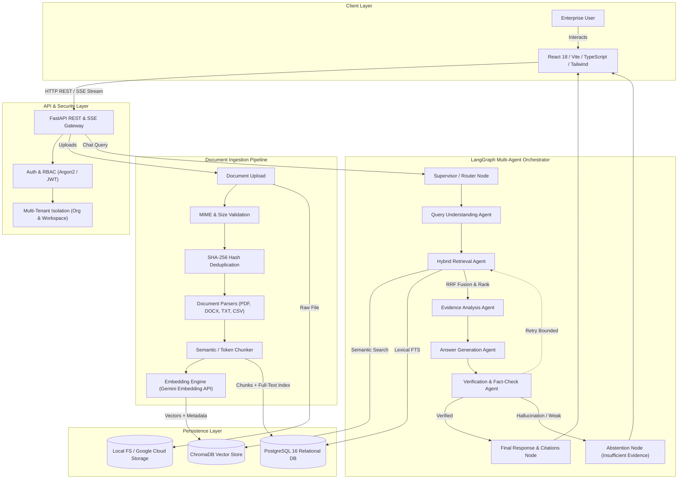
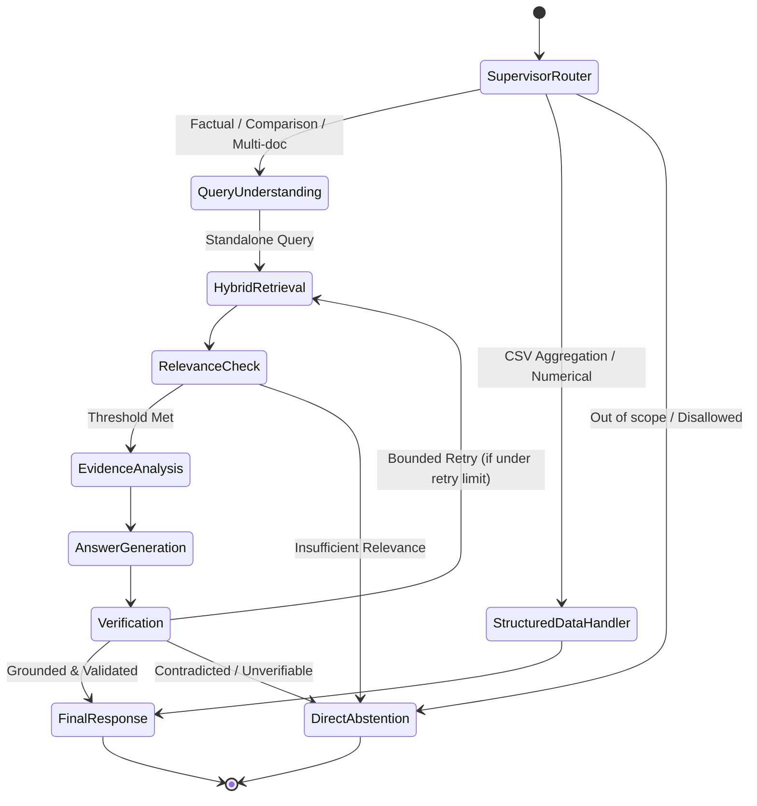
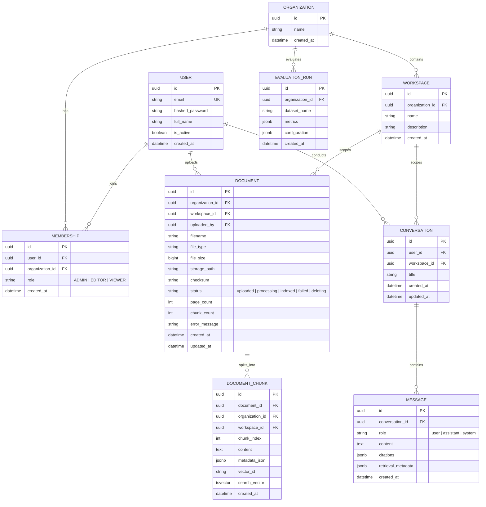

# System Architecture: Enterprise AI Knowledge Assistant

## 1. Executive Summary

The **Enterprise AI Knowledge Assistant** is a full-stack, enterprise-grade Retrieval-Augmented Generation (RAG) platform. It allows organizations to upload internal documents (PDFs, DOCX, TXT, CSV), index them into hybrid search stores, and ask complex natural-language questions through a stateful multi-agent LangGraph workflow powered by Google Gemini.

The system is designed with strict multi-tenancy, zero-trust document handling, verifiable document-level citations, automated answer verification, and an abstention mechanism when evidence is insufficient.

---

## 2. High-Level Architecture



---

## 3. Subsystem Breakdown

### 3.1 Frontend Layer
- **Framework:** React with TypeScript, Vite build tool, Tailwind CSS, and Lucide React icons.
- **State Management:** TanStack Query v5 for server state caching and optimistic updates; React Context for authentication and active workspace selection.
- **Key Modules:**
  - `Auth`: User login, organization registration, session management.
  - `KnowledgeBase`: Multi-file drag-and-drop upload, ingestion status indicators, document deletion, retry triggers.
  - `Chat`: Conversational UI with markdown rendering, live agent progress indicators, citation pills, interactive source-inspection side panel, and follow-up query suggestions.
  - `Dashboard`: Real-time analytics on indexed documents, chunk distributions, and recent queries.
  - `Evaluation`: Visual breakdown of RAG evaluation benchmarks (Faithfulness, Relevance, Latency).

### 3.2 API & Core Backend Layer
- **Framework:** FastAPI with asynchronous request handlers, Pydantic v2 schemas for bidirectional validation, and dependency injection for clean service decoupling.
- **Security & Authorization:**
  - Password hashing via Argon2.
  - Stateless JWT access and refresh token cycles.
  - Role-Based Access Control (RBAC): `ADMIN`, `EDITOR`, `VIEWER`.
  - Multi-tenant tenant scoping enforced at the database and vector queries (never in-memory or on the client).

### 3.3 Document Ingestion Engine
1. **Validation:** Checks MIME types, file extensions, and enforces maximum file size (default 25 MB).
2. **Deduplication:** Calculates SHA-256 checksum of raw files to prevent redundant storage and duplicate indexing.
3. **Parsers:**
   - **PDF:** PyMuPDF (`fitz`) extracting clean text, page numbers, and structural blocks. Detects scanned PDFs when character counts fall below threshold and flags for OCR.
   - **DOCX:** `python-docx` extracting paragraph hierarchies and document tables.
   - **TXT / Markdown:** Native parsing preserving code fences and markdown structure.
   - **CSV:** `pandas` and standard CSV tools converting rows into key-value entity representations, avoiding whole-table flattening.
4. **Chunking:** Configurable chunking (default ~1000 tokens with 150 token overlap). Preserves page numbers, section headers, and tabular contexts.
5. **Metadata Tagging:** Attaches `organization_id`, `workspace_id`, `document_id`, `filename`, `page_number`, `chunk_index`, and `file_type` to every chunk.

### 3.4 Storage & Hybrid Retrieval
- **PostgreSQL 16:**
  - Single source of truth for users, organizations, workspaces, document metadata, chunks, conversations, and evaluation runs.
  - Full-Text Search (FTS) using `tsvector` and `tsquery` with GIN indexing for high-speed lexical search.
- **ChromaDB Vector Store:**
  - Stores chunk embeddings with metadata dictionaries.
  - Pre-filtered by `organization_id` and `workspace_id` directly in the query clause.
- **Hybrid Fusion Engine:**
  - Combines vector cosine similarity ranking and PostgreSQL BM25/FTS ranking using **Reciprocal Rank Fusion (RRF)**:
    $$RRF(d) = \sum_{m \in M} \frac{1}{k + r_m(d)}$$
    (where $k=60$, $r_m(d)$ is the rank in system $m$).
- **Context Budget Manager:** Deduplicates passages, orders by fused relevance score, and truncates to fit within the configured context window limit (default 4000 tokens).

### 3.5 LangGraph Multi-Agent Orchestration

The reasoning and response cycle runs as a compiled stateful LangGraph:



#### Graph State Schema
```python
class AgentState(TypedDict):
    user_id: str
    organization_id: str
    workspace_id: str
    conversation_id: str
    original_query: str
    rewritten_query: str
    query_type: str  # factual, comparison, structured, summarization, etc.
    retrieved_chunks: list[dict]
    evidence_summary: str
    generated_answer: str
    citations: list[dict]
    verification_passed: bool
    verification_notes: str
    retry_count: int
    confidence_score: float
    execution_trace: list[dict]
    error_message: str | None
```

### 3.6 Citations & Grounding Protocol
- Factual claims in the generated response must include numerical bracketed references, e.g., `[1]`, `[2]`.
- Each citation corresponds to an exact chunk retrieved during the session.
- The `VerificationAgent` parses every citation tag, locates the corresponding chunk, and runs an NLI (Natural Language Inference) entailment check:
  - If any claim cannot be entailed by its referenced chunk, the answer is flagged as hallucinated and rejected or rewritten.
  - Non-existent page numbers or fabricated file references trigger immediate failure.

### 3.7 Database Schema (Entity Relationship Diagram)



---

## 4. Security & Zero-Trust Threat Model

1. **Untrusted Document Context:**
   - Raw document contents are treated as untrusted user inputs.
   - Prompts strictly encapsulate context within delimited XML blocks (`<context>...</context>`).
   - System prompts explicitly instruct the LLM to ignore any instructions inside the document text attempting to override guidelines, escalate privileges, or leak system prompts.
2. **Tenant Scoping:**
   - Every database query requires explicit matching on `organization_id` and `workspace_id`.
   - Every vector query mandates a `where={"$and": [{"organization_id": ...}, {"workspace_id": ...}]}` filter.
   - Cross-tenant data leakage is prevented at the query generation layer.
3. **Secret Isolation:**
   - Environment variables are managed via `.env` locally and Google Secret Manager in production.
   - Frontend never receives backend API keys, Gemini tokens, or raw database connection strings.

---

## 5. Deployment Architecture

- **Local Development:** Multi-container `docker-compose.yml` hosting FastAPI backend, React frontend, PostgreSQL 16, ChromaDB server, and Redis.
- **Production (Google Cloud Run):**
  - **FastAPI Backend:** Containerized Cloud Run service with auto-scaling (0 to N instances).
  - **PostgreSQL:** Managed Cloud SQL (PostgreSQL 16) with private VPC connection.
  - **Document Storage:** Google Cloud Storage (GCS) bucket with IAM service account authentication.
  - **Vector DB:** Persistent ChromaDB container on Cloud Run with mounted persistent storage or managed cloud vector instance.
  - **Frontend:** Google Cloud Storage + Cloud CDN or containerized NGINX on Cloud Run.
