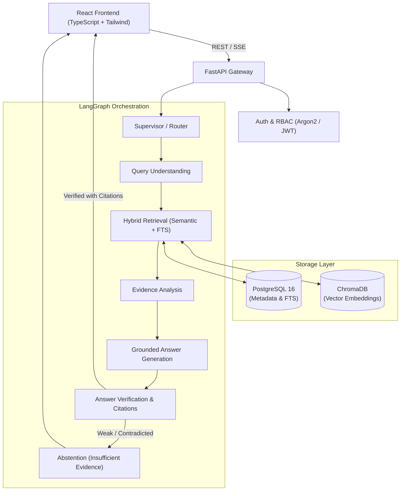

# Enterprise AI Knowledge Assistant

Enterprise AI Knowledge Assistant is a production-grade Retrieval-Augmented Generation (RAG) platform with multi-agent orchestration using LangGraph and Google Gemini.

It allows organizations to ingest enterprise documentation (PDF, DOCX, TXT, CSV), build hybrid search indexes, and interact with their internal knowledge base with verifiable citations, answer verification, and strict multi-tenant isolation.

---

## Architecture Overview



---

## Technology Stack

- **Backend:** Python 3.12, FastAPI, Pydantic v2, SQLAlchemy 2.0 (Async), Alembic.
- **AI & Orchestration:** Google Gemini API (`gemini-1.5-pro` / `gemini-1.5-flash`), LangChain, LangGraph stateful multi-agent graphs.
- **Vector & Storage:** ChromaDB, PostgreSQL 16 (Relational & `tsvector` FTS), Redis.
- **Frontend:** React 18, TypeScript, Vite, Tailwind CSS, TanStack Query, React Router v6.
- **Infrastructure:** Docker, Docker Compose, Google Cloud Run readiness.
- **Testing:** Pytest, HTTPX, Pytest-Asyncio.

---

## Monorepo Structure

```text
enterprise-ai-knowledge-assistant/
├── backend/                  # FastAPI backend service
│   ├── app/
│   │   ├── api/v1/          # REST & SSE route controllers
│   │   ├── core/            # Config, security, logging, exceptions
│   │   ├── db/              # SQLAlchemy session & ORM models
│   │   ├── schemas/         # Pydantic validation schemas
│   │   ├── repositories/    # Database query abstractions
│   │   ├── services/        # Core business logic
│   │   ├── ingestion/       # Document parsers, chunking & pipeline
│   │   ├── rag/             # LangGraph stateful agents & hybrid retrieval
│   │   ├── evaluation/      # RAG evaluation services
│   │   └── observability/   # Tracing & metric logging
│   ├── tests/               # Pytest automated test suite
│   ├── requirements.txt     # Pinned Python dependencies
│   └── Dockerfile           # Multi-stage Python 3.12 build
├── frontend/                 # React 18 + Vite frontend
│   ├── src/                 # Components, pages, hooks, services, types
│   ├── package.json         # Pinned frontend dependencies
│   └── Dockerfile           # Multi-stage Node + Nginx build
├── infrastructure/           # Docker Compose & Cloud Run configs
├── evaluation/               # Evaluation datasets and runners
├── docs/                     # In-depth architectural & deployment guides
├── ARCHITECTURE.md           # System design & ER diagrams
├── TASKS.md                  # Milestone progress checklist
├── .env.example              # Configuration environment template
└── docker-compose.yml        # Multi-service local composition
```

---

## Getting Started

### 1. Prerequisites
- Docker Engine & Docker Compose (Recommended)
- OR: Python 3.12+, Node.js 20+, PostgreSQL 16, ChromaDB

### 2. Configure Environment
```bash
cp .env.example .env
# Edit .env and supply your GEMINI_API_KEY and secure SECRET_KEY
```

### 3. Launch via Docker Compose
```bash
docker compose up --build
```
- Frontend: `http://localhost:3000`
- Backend API & OpenAPI Docs: `http://localhost:8000/docs`
- ChromaDB: `http://localhost:8001`
- PostgreSQL: `localhost:5432`

---

## Implementation Status

Track implementation progress and task breakdown in [TASKS.md](TASKS.md).
Detailed system design and data models are documented in [ARCHITECTURE.md](ARCHITECTURE.md).
